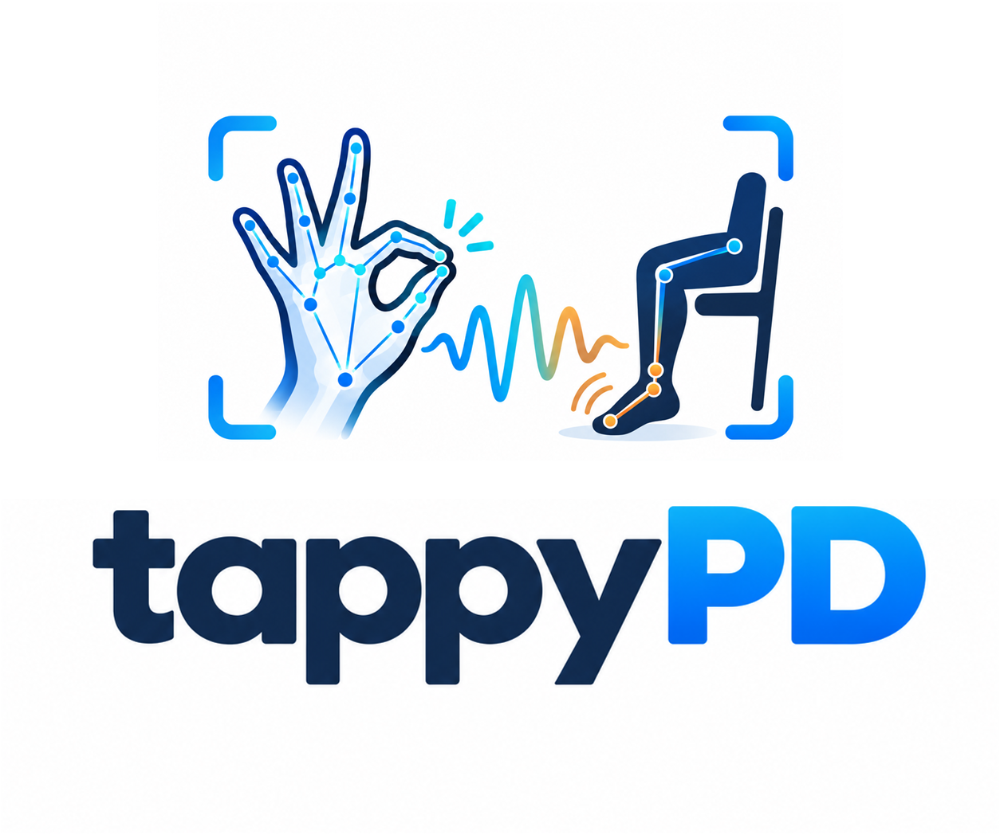
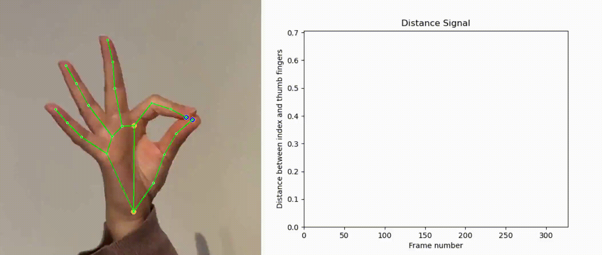
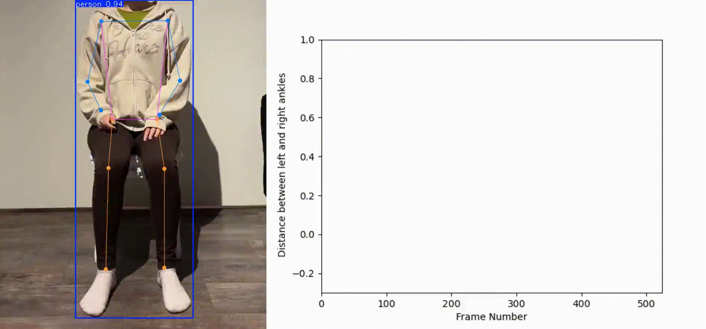

<p align="center">
  
</p>


<h2 align="center">Video-based quantification of motor characteristics in Parkinson's disease</h2>

<p align="center">
  <a href="#installation">Installation</a> ·
  <a href="#usage">Usage</a> ·
  <a href="#publications">Publications</a> ·
  <a href="#citation">Citation</a> ·
  <a href="LICENSE">License</a>
</p>

tappyPD is an open-source tool for analyzing finger tapping and leg agility from MDS-UPDRS video. It extracts movement keypoints, computes motor characterisitics measures, and supports visualization.

## Demo previews

<table>
  <tr>
    <th>Finger tapping</th>
    <th>Leg agility</th>
  </tr>
  <tr>
    <td width="50%"></td>
    <td width="50%"></td>
  </tr>
</table>

## Publications

This repository contains the official implementation of our papers:  

### Finger tapping

**[Interpretable and Granular Video-Based Quantification of Motor Characteristics from the Finger Tapping Test in Parkinson's Disease](https://doi.org/10.1038/s41531-026-01307-w).**

Tahereh Zarrat Ehsan, Michael Tangermann, Yağmur Güçlütürk, S. Shin, K. C. Ho, Bastiaan R. Bloem, Luc J. W. Evers  
*npj Parkinson's Disease*, 2026.

### Leg agility

**[Video-based quantification of leg agility in Parkinson’s disease and its relationship to upper extremity motor impairments](https://doi.org/10.1038/s41531-026-01558-7).**

Tahereh Zarrat Ehsan, Michael Tangermann, King Chung Ho, Bastiaan R. Bloem, Luc J. W. Evers  
*npj Parkinson's Disease*, 2026.

---

## 📂 Repository Structure

```
📁 VideoBased-PD-Biomarkers/
│
├── 📁 src/
│ └── 📁 demo/
│ └── 📄 ft_video_analysis.py # demo: finger tapping video → features → plots
│ └── 📄 la_video_analysis.py # demo: leg agility video →  features → plots
│ ├── 📁 preprocessing/
│ │ └── 📄 keypoint_extraction.py # Extracts keypoints 
│ ├── 📁 feature_extraction/
│ │ └── 📄 feature_extraction.py # Computes motor features (amplitude, speed, etc.)
│ ├── 📄 environment.yml # Conda environment setup
├── 📁 data/
│ ├── 📁 raw/ # Raw data and extracted keypoints (.pkl)
│ └── 📁 processed/ # Processed CSVs and derived feature files
└── 📘 README.md # Project documentation
```

---

## Installation

Clone the repository:

```bash
git clone https://github.com/biomarkersParkinson/tappyPD.git
cd tappyPD
```

### Conda
```bash
conda env create -f environment.yml
conda activate pd_marker
```

---
## Usage
### video → motor quantification

This demo offers a simple end-to-end example that runs the full analysis pipeline — from a raw video to automatic feature extraction and visualization.
It can be executed locally without any dataset setup or preprocessing steps from the main implementation.

#### Finger Tapping 

📁 Script location
    ```
src/demo/ft_video_analysis.py
    ```

▶️ Run the demo
```bash
python src/demo/ft_video_analysis.py --video_path "src/demo/finger_tapping_test.mp4" --hand2track Right
```
Arguments:
    ```
--video_path: Path to the input video file
--hand2track: Which hand to analyze (Left or Right)
    ```

#### Leg Agility 

Script location
    ```
src/demo/la_video_analysis.py
    ```

▶️ Run with YOLO backend
```bash
python src/demo/la_video_analysis.py --video_path "src/demo/leg_agility_test.mp4" --leg2track Right --backend yolo
```

▶️ Run with Metrabs backend
```bash
python src/demo/la_video_analysis.py --video_path "src/demo/leg_agility_test.mp4" --leg2track Right --backend metrabs
```

Arguments:
    ```
--video_path: Path to the input leg-agility video file
--leg2track: Which leg to analyze (Left or Right)
--backend: Pose-estimation backend (yolo or metrabs)
--save_dir: Optional output directory
    ```

    
## 📥 Data Access

Data from the [Personalized Parkinson Project](https://www.personalizedparkinsonproject.com/home) used in the present study were retrieved from the [PEP database](https://pep.cs.ru.nl/index.html).  
The PPP data are available upon request via [ppp-data@radboudumc.nl](mailto:ppp-data@radboudumc.nl).  
More details on the procedure can be found on the [project website](https://www.personalizedparkinsonproject.com/home).

---

## Citation

If you use this repository in your research, please cite the relevant paper(s) below.

### Finger tapping

> Zarrat Ehsan, T., Tangermann, M., Güçlütürk, Y., Shin, S., Ho, K. C., Bloem, B. R., & Evers, L. J. W.  
> *Interpretable and Granular Video-Based Quantification of Motor Characteristics from the Finger-Tapping Test in Parkinson’s Disease.*  
> **npj Parkinson’s Disease**, 2026.  
> https://doi.org/10.1038/s41531-026-01307-w

### Leg agility

> Zarrat Ehsan, T., Tangermann, M., Ho, K. C., Bloem, B. R., & Evers, L. J. W.  
> *Video-based quantification of leg agility in Parkinson’s disease and its relationship to upper extremity motor impairments.*  
> **npj Parkinson’s Disease**, 2026.  
> https://doi.org/10.1038/s41531-026-01558-7

---

## 📘 BibTeX

```bibtex
@article{zarratehsan2026finger,
  title = {Interpretable and Granular Video-Based Quantification of Motor Characteristics from the Finger-Tapping Test in Parkinson's Disease},
  author = {Zarrat Ehsan, Tahereh and Tangermann, Michael and G{\"u}{\c{c}}l{\"u}t{\"u}rk, Ya{\u{g}}mur and Shin, S. and Ho, K. C. and Bloem, Bastiaan R. and Evers, Luc J. W.},
  journal = {npj Parkinson's Disease},
  year = {2026},
  doi = {10.1038/s41531-026-01307-w}
}

@article{zarratehsan2026leg,
  title = {Video-based quantification of leg agility in {Parkinson's} disease and its relationship to upper extremity motor impairments},
  author = {Zarrat Ehsan, Tahereh and Tangermann, Michael and Ho, King Chung and Bloem, Bastiaan R. and Evers, Luc J. W.},
  journal = {npj Parkinson's Disease},
  year = {2026},
  doi = {10.1038/s41531-026-01558-7}
}
```

---

## 📜 License

This project is licensed under the Apache 2.0 License.


### 📜 Third-party licenses

This project uses third-party software and models with their respective licenses. Ultralytics YOLO is licensed under AGPL-3.0, MediaPipe is licensed under Apache-2.0, and the MeTRAbs source code is licensed under the MIT License. MeTRAbs pretrained models are provided for non-commercial use only and are subject to the licensing restrictions specified by the MeTRAbs authors.
